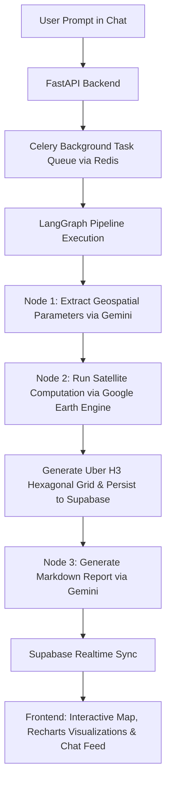
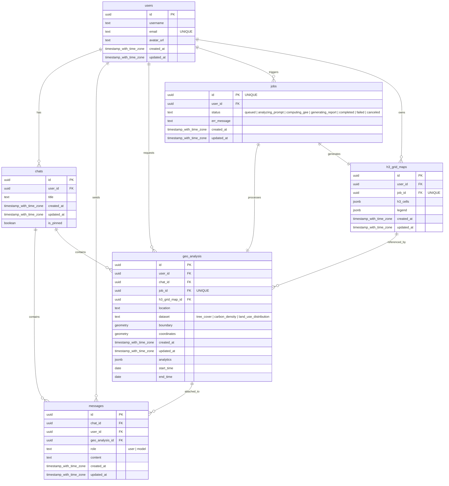

# Geospatial AI Assistant

Geospatial AI Assistant is an agentic platform that analyzes satellite-derived environmental data and planetary carbon metrics using natural language queries. It combines large language models with Google Earth Engine (GEE) and Uber H3 spatial indexing to automate geospatial intelligence workflows.

---

## Working Flow

The system processes conversational requests through an asynchronous, graph-orchestrated pipeline:



### Step-by-Step Execution

1. **User Query Submission**: The user submits a natural-language query through the chat interface describing a location and environmental metric (such as tree cover, biomass carbon density, or land-use distribution).
2. **Intent Classification & Parameter Parsing**: The backend routes the request into a LangGraph state machine. Node 1 uses Gemini and a geocoding tool to resolve geographic boundaries, bounding coordinates, target timeframes, and dataset selection.
3. **Satellite Computation & Spatial Indexing**: Node 2 executes the analysis asynchronously on Google Earth Engine (GEE). Continuous raster data is aggregated and indexed into hexagonal cells using Uber H3.
4. **Data Persistence**: Computed metrics, GeoJSON boundaries, and H3 hexagonal cell datasets are stored in PostgreSQL with PostGIS extensions via Supabase.
5. **Report Generation**: Node 3 synthesizes the analytical output into a structured scientific markdown report with inline chart definitions.
6. **Real-time Client Delivery**: Supabase Realtime notifies the React frontend, which dynamically renders the Leaflet map with H3 grid overlays and Recharts analytical graphs.

---

## Database Schema

The database is built on PostgreSQL with the PostGIS extension, managed through Supabase:



---

## Folder Structure

```text
.
├── backend/
│   ├── app/
│   │   ├── auth/              # Authentication endpoints, models, and schemas
│   │   ├── chat/              # Chat sessions, messaging routes, and schemas
│   │   ├── geo_analysis/      # Spatial data services, GEE integration, and models
│   │   ├── job/               # Background job tracking endpoints and models
│   │   ├── llm/
│   │   │   ├── agent/         # Gemini agent tool definitions, schemas, and prompts
│   │   │   ├── graph/         # LangGraph state machine, pipeline nodes, and recovery
│   │   │   └── tasks.py       # Celery task definitions for analysis jobs
│   │   ├── dependencies.py    # Database connection and shared FastAPI dependencies
│   │   ├── server.py          # FastAPI application entry point
│   │   └── worker.py          # Celery and Redis worker initialization
│   ├── db.sql                 # PostgreSQL / PostGIS database setup script
│   ├── Dockerfile             # Multi-stage Docker build for API and worker
│   ├── requirements.txt       # Backend Python dependencies
│   └── README.md              # Backend technical documentation
├── frontend/
│   ├── src/
│   │   ├── api/               # REST API clients for backend communication
│   │   ├── assets/            # Vector graphic assets
│   │   ├── components/        # Reusable UI components (chat, map, analytics, sidebar)
│   │   ├── contexts/          # React context providers (auth, theme, alerts)
│   │   ├── hooks/             # Controller custom hooks
│   │   ├── pages/             # Views (Layout, Login, Register, ProtectedRoute)
│   │   ├── stores/            # Zustand state stores (chat, map, analytics, messages)
│   │   ├── types/             # TypeScript domain interfaces and types
│   │   └── utils/             # Helper utilities
│   ├── Dockerfile             # Frontend container build definition
│   ├── jest.config.ts         # Testing configuration
│   ├── package.json           # Frontend dependencies and npm scripts
│   ├── vite.config.ts         # Vite bundler configuration
│   └── README.md              # Frontend technical documentation
├── docker-compose.yml         # Container orchestration (frontend, API, worker, Redis)
├── Makefile                   # Environment orchestration commands
└── README.md                  # Project overview documentation
```

---

## Quickstart

Run the full stack locally with Docker Compose:

```bash
docker-compose up --build
```

- **Frontend UI**: `http://localhost:5173`
- **Backend API**: `http://localhost:8000`
- **Interactive Docs**: `http://localhost:8000/docs`

