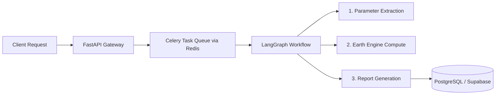

# Geospatial AI Assistant — Backend

The backend is an asynchronous, agent-driven service that transforms natural language queries into satellite-derived environmental analytics using Google Earth Engine (GEE) and LangGraph.

---

## Architecture Overview



### Core Components

| Component | Technology | Responsibility |
|---|---|---|
| **API Gateway** | FastAPI | REST endpoints for authentication, chat sessions, and job tracking |
| **Agent Orchestration** | LangGraph (`StateGraph`) | Stateful execution flow with Pydantic schema validation and retry policies |
| **LLM Engine** | Google Gemini (`google-genai`) | Query classification, GIS parameter extraction, and scientific report synthesis |
| **Geospatial Compute** | Google Earth Engine (GEE) | Satellite raster processing (Sentinel-2, MODIS, ESA WorldCover) and H3 indexing |
| **Task Queue** | Celery + Redis | Asynchronous job processing to decouple heavy GIS compute from the API |
| **Database** | PostgreSQL + PostGIS (Supabase) | User auth, chat history, spatial geometries, and cached analysis results |

---

## Execution Pipeline

1. **Intent Classification & Parameter Parsing**: When a user submits a prompt, Gemini classifies the intent and extracts structured parameters (`GeoSpatialQuery`: location, bounding box, dataset, and timeframe). Geocoding resolves location names to coordinates via OpenStreetMap Nominatim.
2. **Satellite Computation**: An asynchronous Celery worker invokes Google Earth Engine to compute the requested environmental metric:
   - **Tree Cover & Carbon Density**: Downscales coarse biomass/canopy data using Sentinel-2 NDVI linear regression.
   - **Land-Use Distribution**: Computes categorical class frequencies via ESA WorldCover.
3. **Spatial Indexing (Uber H3)**: Raster statistics are aggregated into hexagonal cells (resolutions 7–8) for lightweight client rendering.
4. **Report Generation & Delivery**: Gemini synthesizes the numerical findings into a markdown report with embedded chart directives, written to the database and synced to the client in real time.

---

## Project Structure

```text
backend/app/
├── auth/           # User authentication and JWT handling
├── chat/           # Chat session management and message persistence
├── geo_analysis/   # GEE computation, H3 indexing, and spatial services
├── job/            # Background task status tracking
├── llm/
│   ├── agent/      # Gemini prompts, Pydantic schemas, and tool calling
│   ├── graph/      # LangGraph state machine, nodes, and error handling
│   └── tasks.py    # Celery task definitions
├── server.py       # FastAPI application entry point
└── worker.py       # Celery worker process
```

---

## Quickstart

### Prerequisites
- Python 3.11+
- Redis and PostgreSQL (or Supabase instance)
- Google Earth Engine Service Account credentials
- Gemini API Key

### Running Locally

```bash
# 1. Install dependencies
pip install -r requirements.txt

# 2. Start the API server
uvicorn app.server:app --host 0.0.0.0 --port 8000 --reload

# 3. Start the Celery worker (in a separate terminal)
celery -A app.worker.celery_app worker --loglevel=info
```
