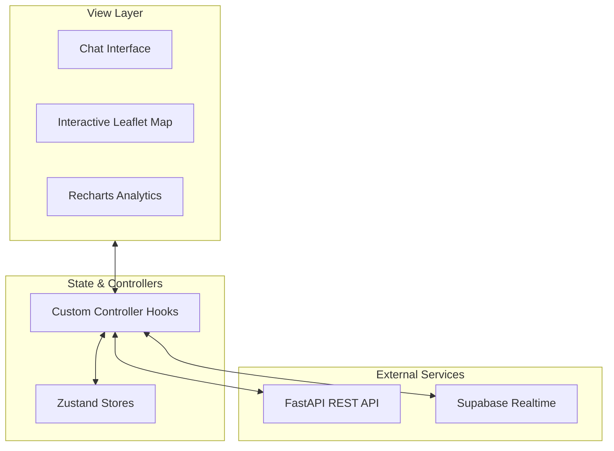

# Geospatial AI Assistant — Frontend

The frontend is a React single-page application built with TypeScript, Leaflet, and Chakra UI. It delivers an interactive chat interface paired with real-time geospatial map visualization and dynamic analytical charts.

---

## Architecture Overview



### Core Architecture

- **Zustand Stores (Model)**: Lightweight, domain-specific stores (`useChatStore`, `useMessageStore`, `useMapStore`, `useAnalyticsStore`) maintain client state without network side-effects.
- **Custom Controller Hooks (Controller)**: Encapsulate API communication, real-time WebSocket subscriptions, and business logic (e.g., `useMapController`, `useChatController`).
- **Components (View)**: Presentational UI built on Chakra UI, consuming clean controller contracts.

---

## Key Features

1. **Interactive Geospatial Map**:
   - Uses `React-Leaflet` configured with canvas rendering for high-performance drawing.
   - Reconstructs hexagonal boundaries client-side from lightweight Uber H3 cell indices (`h3-js`), eliminating heavy GeoJSON transfer over the network.
   - Pre-computed palette coloring ensures instant rendering without client-side data normalization.

2. **Real-time Asynchronous Updates**:
   - Subscribes to Supabase Realtime channels for instant notification when satellite jobs transition from `analyzing_prompt` to `computing_gee` to `completed`.
   - Includes automatic fallback to REST polling if the WebSocket connection experiences transient disconnects.

3. **Dynamic Report & Chart Rendering**:
   - Renders markdown responses with custom component overrides.
   - Intercepts structured directives emitted by the LLM (e.g. `biomass_trends`, `land_use_distribution`) to embed interactive Recharts bar and donut charts inline within the conversation.

---

## Project Structure

```text
frontend/src/
├── api/            # Axios API clients for backend endpoints
├── components/     # UI components (Map, ChatMessages, Analytics, Sidebar)
├── contexts/       # Authentication, theme, and toast providers
├── hooks/          # Controller hooks orchestrating stores and APIs
├── pages/          # Application views (Layout, Login, Register)
├── stores/         # Zustand domain stores
├── types/          # TypeScript domain interfaces
└── utils/          # Formatting and geospatial helpers
```

---

## Quickstart

### Prerequisites
- Node.js 18+
- npm or yarn

### Running Locally

```bash
# 1. Install dependencies
npm install

# 2. Start the Vite development server
npm run dev

# 3. Build for production
npm run build

# 4. Run tests
npm test
```
